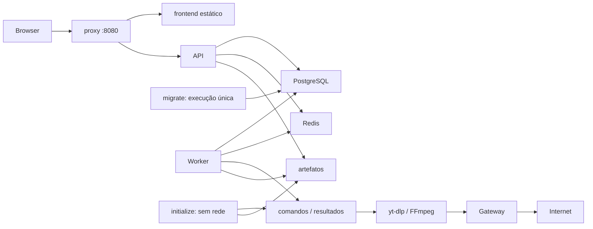

# Operação VideoFlow

## Topologia e privilégios



Redes: `entry` permite entrada no proxy; `frontend` interna liga proxy/frontend; `app` interna liga proxy/API; `data` interna liga API/worker/migrate/PostgreSQL/Redis; `media` interna isolada liga sandbox/gateway; `outbound` somente gateway alcança Internet. Nenhum container da aplicação monta Docker socket ou usa privileged. Apenas proxy publica `127.0.0.1:8080`.

No projeto de aceitação, a fixture sintética participa de outbound e não publica porta; apenas o gateway de teste aceita seu hostname exato e porta 80. Quality participa de data/app/outbound para executar testes e instalar dependências; E2E usa app/data/entry para navegador e preparação de dados. Esses serviços não existem na composição de produção. Restore tem somente PostgreSQL em uma rede própria. Projetos e volumes são separados.

O proxy sobrescreve X-Forwarded-For/Proto/Real-IP e remove Forwarded. A API confia somente no primeiro salto que corresponda ao DNS interno de videoflow-proxy, renovado a cada 5 segundos e descartado se DNS falhar. Não confia em toda rede privada. Origin e capacidade continuam verificados no Fastify. Logs de acesso do proxy não incluem URL, cookies ou corpo. Streaming passa sem buffering, preserva Range e encerra no cliente desconectado; timeout de inatividade é 300 s. Limite de corpo 16 KiB, limite de rajada no proxy e quotas Redis da API se complementam.

Usuários: node para Node/mídia, nginx para web/proxy, postgres e redis nas respectivas imagens. Serviço initialize usa root somente para chown das raízes dos quatro volumes de mídia, sem rede e com apenas CHOWN acrescentado. Serviços contínuos têm read-only, tmpfs, cap_drop ALL, no-new-privileges, init, limites e restart unless-stopped. Migrate/initialize terminam e não reiniciam. Não se exige que um serviço de execução única apareça running após exit 0.

## Volumes e limites

| Volume | Leitores/escritores |
|---|---|
| pg-data | PostgreSQL |
| redis-data | Redis AOF everysec, noeviction, maxmemory 192 MiB |
| commands | worker RW, sandbox RO |
| results | worker/sandbox RW |
| temporary | worker/sandbox RW |
| artifacts | worker RW, API RO |

Não se compartilha mídia com frontend, proxy ou gateway. Qualidade tem volumes adicionais exclusivamente no projeto de teste. Memória: web/proxy 128 MiB, API/worker/PostgreSQL 512 MiB, Redis/gateway 256 MiB, sandbox 2 GiB; sandbox 2 CPU, API/worker 1 CPU, 128 PIDs por serviço. Dados maiores que RAM persistem em volumes, sujeitos às quotas da aplicação e espaço físico do Docker.

Valores aprovados no código: 2 execuções globais, 3 jobs ativos por contexto, 100 globais, 2 GiB de entrada e 1 GiB de saída, 2 h de mídia, 30 min de job, 10 min de inspeção, 24 h de artefato e até 30 dias de histórico/contexto. Não há override ambiental fictício para esses limites. Reserva mínima de disco e limpeza respeitam leases; observar espaço do Docker no host. Limites e monitoramento não substituem provisionamento de disco.

## Inicialização e migrations

`docker compose up -d --build` constrói imagens fixadas, aguarda PostgreSQL/Redis, aplica migrations uma vez, inicializa permissões e inicia serviços. Falha do migrate bloqueia API/worker. Investigue `docker compose logs videoflow-migrate`; não apague banco para resolver migration.

Atualização planejada: faça backup, pare admissão/processamento numa janela de manutenção, reconstrua e execute `docker compose run --rm videoflow-migrate`, depois `docker compose up -d`. Uma migration incompatível pode impedir rollback de imagem: ensaie restauração antes de atualizar.

## Saúde, logs e recuperação

```sh
docker compose ps -a
docker compose logs --tail 100 videoflow-api videoflow-worker videoflow-media-sandbox
docker compose restart videoflow-api
docker compose stop
docker compose up -d
```

API verifica banco/Redis com prazo curto; worker verifica heartbeat e conectividade; sandbox verifica heartbeat, spool e binários; gateway verifica listener; PostgreSQL pg_isready, Redis PING e frontend/proxy HTTP. Proxy verifica também API e frontend. Health verde não comprova conversão. As tentativas/leases/outbox persistidas reconciliam interrupções; Redis AOF everysec admite perda da última janela, coberta pela reconciliação do banco. Logs JSON têm rotação 10 MiB x3. Logs nativos de ferramentas não são publicados na API.

Limpeza operacional:

```sh
docker compose exec -T videoflow-worker node workers/media-worker/dist/cleanup-main.js
```

Usa a mesma retenção e advisory lock da limpeza periódica. Preserva artefatos válidos e temporários com leases vigentes; nunca substitua por remoção recursiva de diretórios.

## Backup e restauração

`infra/scripts/operate.ps1 backup` ou `sh infra/scripts/operate.sh backup` executa pg_dump custom dentro do PostgreSQL e copia para `backups/`. PowerShell transporta Base64 e grava os bytes decodificados; shell preserva os bytes diretamente. Isso evita redirecionamento binário do Windows PowerShell e não depende de docker cp acessar tmpfs. Proteja os backups: contêm capacidades em hash, URLs e histórico. Os defaults locais não são segredo de produção.

Backup do banco sozinho não contém mídia. Para um snapshot consistente de banco + artefatos, suspenda entrada no proxy e pare API/worker/sandbox, aguarde processos terminarem, faça pg_dump e snapshot/cópia do volume artifacts pela ferramenta de backup, registre versões e momento, então retome. Inclua spool/temporários se quiser preservar operações em andamento; alternativamente reconcilie tentativas interrompidas e não prometa retomada byte a byte. Redis não substitui o banco como fonte de verdade.

Ensaio de restore usa projeto separado em `compose.restore.yaml`, volume próprio e arquivo de backup explicitamente escolhido. Copie o arquivo para `/tmp/restore.dump` do serviço restore-postgres e rode pg_restore sem `--clean` num banco vazio. Confira contagens e dados. Não execute restauração no banco operacional sem plano específico. Scripts desta entrega não excluem volumes.

## Troubleshooting

- Porta ocupada: pare o Vite/Compose anterior do VideoFlow ou configure HTTP_PORT e ORIGIN em conjunto. Não encerre serviços de outro projeto.
- 403 Origin: abra localhost:8080 e confira ORIGIN; não relaxe CORS/Origin.
- 429: aguarde a janela de um minuto; polling em abas ocultas é suspenso, não desative quotas.
- Job sem progresso: confira saúde de worker/sandbox/gateway, tentativas, disco e Redis; não exponha portas para contornar isolamento.
- Fonte bloqueada: confirme propriedade/autorização e política de hosts. Nunca libere uma rede privada para corrigir URL.
- Build sem rede: npm/apt/pip precisam acesso durante build; runtime do sandbox continua sem acesso direto.
- OOM ou disco: confira limites via docker inspect e capacidade do Docker Desktop. Use retenção; não remova volumes como manutenção.
- Falha de migration: preserve volume/log e restaure somente em ensaio isolado antes de intervenção.

Referências: [ordem de inicialização Compose](https://docs.docker.com/compose/how-tos/startup-order/) e [proxy Nginx](https://nginx.org/en/docs/http/ngx_http_proxy_module.html).
